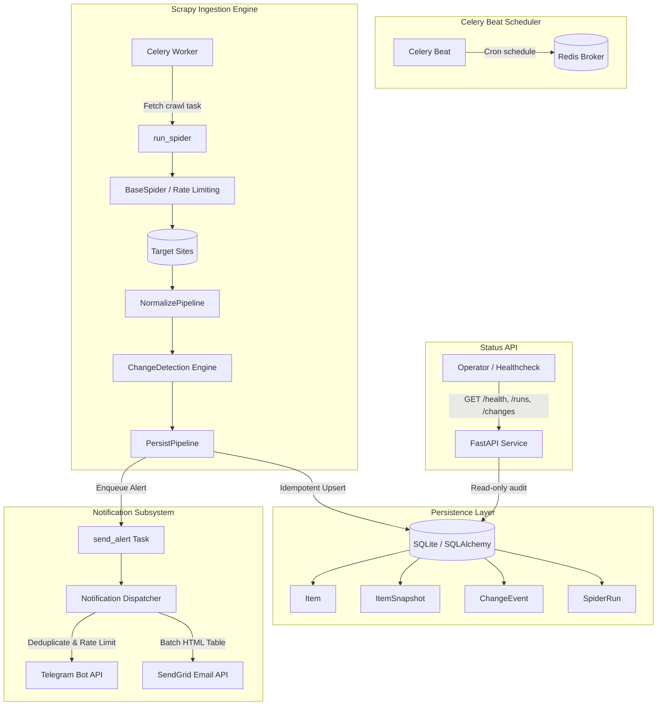

# Watchtower Scraper 🗼

[](https://www.python.org/downloads/)
[](https://opensource.org/licenses/MIT)
[](https://github.com/astral-sh/ruff)

A production-grade monitoring and intelligence system that scrapes major Kenyan job boards (**BrighterMonday**, **Fuzu**, **MyJobMag**) and e-commerce platforms (**Jumia**, **Kilimall**) on an automated schedule, detects new listings and price fluctuations, stores historical diffs, and dispatches structured alerts via **Telegram** and **Email**.

---

## 🎯 Target Platforms

| Platform | Type | Strategy / Detection |
| :--- | :--- | :--- |
| **BrighterMonday** | Job Board | New vacancy detection (`new_listing`), salary & category tracking |
| **Fuzu** | Job Board | New vacancy detection (`new_listing`), employer & location tracking |
| **MyJobMag** | Job Board | New vacancy detection (`new_listing`), contract type tracking |
| **Jumia Kenya** | E-Commerce | Historical price snapshots, price drops (`price_drop`), price increases (`price_increase`) |
| **Kilimall Kenya** | E-Commerce | Historical price snapshots, price changes with configurable threshold (`MIN_PRICE_DELTA_PCT`) |

---

## 🏗️ Architecture



---

## ⚙️ Configuration (`.env`)

Copy `.env.example` to `.env` and fill in your credentials:

```bash
cp .env.example .env
```

| Variable | Description | Default |
| :--- | :--- | :--- |
| `DATABASE_URL` | SQLAlchemy connection string | `sqlite:///./watchtower.db` |
| `REDIS_URL` | Redis URL for Celery broker & result backend | `redis://localhost:6379/0` |
| `TELEGRAM_BOT_TOKEN` | Telegram Bot API token (optional) | *None* |
| `TELEGRAM_CHAT_ID` | Telegram chat or channel ID (optional) | *None* |
| `SENDGRID_API_KEY` | SendGrid API key for HTML email alerts (optional) | *None* |
| `ALERT_FROM_EMAIL` | Sender email address for alerts | `alerts@watchtower.io` |
| `ALERT_TO_EMAILS` | Comma-separated list of alert recipient emails | *None* |
| `PROXIES` | Optional newline or comma-separated proxy list | *None* |
| `DOWNLOAD_DELAY` | Politeness delay between requests (seconds) | `2.0` |
| `ROBOTSTXT_OBEY` | Strict robots.txt compliance | `True` |
| `MIN_PRICE_DELTA_PCT` | Minimum percentage change to emit price alert | `1.0` |
| `MISSING_AFTER_HOURS`| Inactivity hours before marking item as `removed` | `24` |
| `RETENTION_DAYS` | Days before pruning historical snapshots | `90` |
| `LOG_LEVEL` | Logging verbosity (`DEBUG`, `INFO`, `WARNING`) | `INFO` |
| `HTTP_PORT` | Port for the FastAPI status and audit API | `8000` |

---

## 🚀 Running Locally (Virtualenv)

### 1. Prerequisites
Ensure Python 3.11+ and Redis are installed and running:
```bash
redis-server
```

### 2. Setup Virtual Environment
```bash
python -m venv venv
source venv/bin/activate       # On Linux/macOS
# or: .\venv\Scripts\activate  # On Windows

pip install -e ".[dev]"
```

### 3. Initialize Database & Seed Demonstration Data
```bash
# Seed demo items and verify change detection without hitting live websites:
python scripts/seed_demo.py

# Test immediate alert dispatching:
python scripts/seed_demo.py --notify
```

### 4. Start Celery Worker & Beat
In separate terminal windows:
```bash
# Start Celery Worker:
celery -A watchtower.tasks.celery_app worker --loglevel=INFO

# Start Celery Beat Scheduler:
celery -A watchtower.tasks.celery_app beat --loglevel=INFO
```

### 5. Start Status & Inspection API
```bash
uvicorn watchtower.api.main:app --host 0.0.0.0 --port 8000
```
Open [http://localhost:8000/docs](http://localhost:8000/docs) in your browser to inspect interactive Swagger documentation for `/health`, `/runs`, and `/changes`.

---

## 🐳 Running with Docker Compose

Deploy the complete multi-service stack (**Redis**, **Worker**, **Beat Scheduler**, **Status API**) with healthchecks:

```bash
docker compose up -d
```

### Run a One-Off Spider Crawl
Execute any spider on-demand via the dedicated `crawl` service:
```bash
docker compose run --rm crawl brighter_monday
docker compose run --rm crawl jumia
docker compose run --rm crawl fuzu
docker compose run --rm crawl kilimall
docker compose run --rm crawl my_job_mag
```

### View Logs & Status
```bash
docker compose logs -f worker
docker compose ps
```

---

## 🧪 Running Tests

The test suite contains unit and integration tests with offline VCR fixtures:

```bash
# Run quiet test suite:
pytest -q

# Run full test suite with coverage report:
pytest --cov=src/watchtower --cov-report=term-missing tests/unit tests/integration
```

---

## 🧩 Adding a New Spider in ≤ 15 Lines

Inheriting from `BaseSpider` automatically provides rate-limiting, proxy/user-agent rotation, robots.txt compliance, and the persistence pipeline:

```python
from watchtower.spiders.base import BaseSpider

class NewJobSpider(BaseSpider):
    name = "new_job_board"
    allowed_domains = ["jobs.example.co.ke"]
    start_urls = ["https://jobs.example.co.ke/listings"]

    def parse(self, response):
        for card in response.css(".job-card"):
            yield self.build_item(
                site=self.name,
                external_id=card.css("::attr(data-id)").get(),
                url=response.urljoin(card.css("a::attr(href)").get()),
                title=card.css(".title::text").get(),
                company=card.css(".employer::text").get(),
                category="Job",
            )
```

---

## ⚖️ Legal & Ethical Scraping Policy

Watchtower Scraper is built for ethical, low-impact intelligence collection:
1. **Robots.txt Obedience**: `ROBOTSTXT_OBEY=True` is enabled by default across all spiders.
2. **Conservative Rate Limiting**: Spiders utilize Scrapy's AutoThrottle with randomized delays (`DOWNLOAD_DELAY=2.0s`) and strict per-domain concurrency limits (`CONCURRENT_REQUESTS_PER_DOMAIN=2`).
3. **No Anti-Bot Bypassing**: The project strictly does **not** employ CAPTCHA solvers, cloudflare bypass exploits, or illegal access measures. If a site indicates rate limiting or restrictions, the spider logs the event and terminates gracefully.
4. **Data Privacy**: No personal, sensitive, or protected user profiles are stored. Only public job vacancy details and e-commerce product pricing are indexed.

---

## 📄 License
MIT License. Created by the Watchtower Scraper Team.
